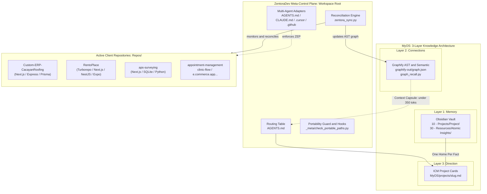
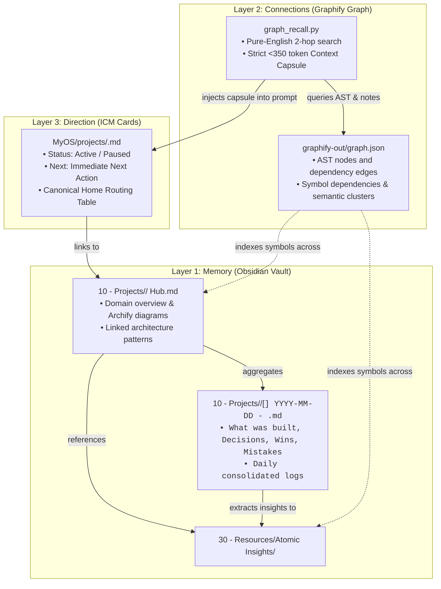

# ZentoraDev - Architecture

Review: repository-grounded draft; pending developer review. Describes observed implementation rather than a proposed application stack.

## Runtime and layout

The root contains PowerShell automation, Python tooling, Markdown instructions, an Obsidian Vault, and Graphify data. There is no root application package manifest defining a frontend or API server. Dependency versions for client applications belong to their independent repositories.

- `MyOS/_meta/`: machine setup, agent setup, repository bootstrap, reconciliation, recall, and verification scripts.
- `MyOS/ObsidianVault/Templates/repo-agents-starter/`: reusable child-repo guidance and documentation templates.
- `MyOS/_meta/global-skills/`: curated skills deployed to `~/.agents/skills` by machine setup.
- `Repos/`: independently tracked projects, excluded from root version control.

## Knowledge boundaries

Live project status belongs to project cards; historical context belongs to project Vault folders; graph connections belong to the global graph. [Memory routing](MEMORY.md) links to their actual homes. Project planning documents do not replace these stores.

## Onboarding flow

Manual `bootstrap_repo.ps1` and Python `zentora_sync.py` both invoke [the shared scaffolder](../MyOS/_meta/scaffold_project_docs.py). It creates missing six-file templates and onboarding guidance and adds a marked AGENTS.md reference once. It does not infer product requirements or migrate authored documents.

Manual bootstrap prints a next-step interview prompt. Automatic onboarding does not launch an interview. The coding agent later inspects repo evidence, drafts missing content, interviews the developer, and consolidates after review.

## Security skill

The complete Cloudflare skill is bundled globally with pinned provenance and attribution. Machine setup deploys the collection; child repos reference it without local copies. See [upstream provenance and runtime limitations](../MyOS/_meta/global-skills/security-audit/UPSTREAM.md). Native Windows cannot run the pinned validator CLIs; full audits require a supported runtime and upstream sandbox protections.

## Architecture references

System overview and knowledge-layer planning content is consolidated below. Backend protocols are in [RULES.md](RULES.md); agent lifecycle and release workflows are in [TASKS.md](TASKS.md). The former planning-document paths contain redirects.

- **Interactive Architecture Diagram (HTML):** [system-architecture.html](architecture/system-architecture.html)
- **Architecture Diagram Source (Mermaid):** [system-architecture.mmd](architecture/system-architecture.mmd)

Preserve any child-repo Archify artifacts in their respective repositories.

## Open questions

Confirm any desired architecture changes separately. No new runtime, persistence layer, or service deployment is proposed by this documentation update.

## System overview reference

ZentoraDev is a local-first **Meta-Developer Operating System (MyOS)** designed to orchestrate autonomous AI pair programming across multiple independent client repositories. It enforces disciplined engineering guardrails, maintains persistent cross-session memory, and eliminates token waste through automated 2-hop knowledge graph retrieval.

---

### 1. What ZentoraDev Is & What It Is Used For

In multi-repository development environments, AI coding assistants (such as Google Antigravity, Cursor, and Claude Code) suffer from three fatal flaws when switching across projects:
1. **Context Amnesia:** Every new chat session loses prior architectural decisions, historical bugs, and database schemas.
2. **Context Window Saturation:** Dumping entire codebases or unindexed notes into prompts exhausts token budgets and leads to hallucinated implementations.
3. **Architectural Drift:** Without strict protocols, AI assistants introduce inconsistent patterns, violate separation of concerns, and overengineer simple CRUD workflows.

**ZentoraDev solves these challenges by acting as the central intelligence and control plane:**
- **Centralized Long-Term Memory:** Retains all dated session logs, architectural decisions, and atomic gotchas in an Obsidian Vault (`MyOS/ObsidianVault/`).
- **Graph-Powered Zero-Token Retrieval:** Maintains an AST symbol dependency graph and semantic community map (`MyOS/graphify-out/graph.json`) to inject precise, <350 token Context Capsules.
- **Strict Architectural Governance:** Enforces the 10 Backend Engineering Protocols (ZEP) and a Two-Tier Simplicity Gate across all child projects in `Repos/`.
- **Autonomous Tooling Bootstrapper:** Onboards client repositories with shared guidance, git hooks, portable paths, and developer-led documentation review.

---

### 2. High-Level System Architecture



---

### 3. Core Operating Invariants

#### Invariant 1: One Home Per Fact (Routing Integrity)
Each piece of project information has exactly one canonical owner to prevent conflicting state:
- **Live Status & Next Immediate Task:** Lives **ONLY** in `MyOS/projects/<project-slug>.md`.
- **Session History, Decisions & Wins:** Lives **ONLY** in `MyOS/ObsidianVault/10 - Projects/<Project Name>/[<CODE>] YYYY-MM-DD - <Focus Title>.md`.
- **Reusable Architectural Gotchas:** Lives **ONLY** in `MyOS/ObsidianVault/30 - Resources/Atomic Insights/`.
- **Code Dependencies & Relationships:** Lives **ONLY** in `MyOS/graphify-out/graph.json`.

#### Invariant 2: Zero Token Waste
Routine prompts must never force AI agents to re-read multi-thousand-line repositories or unindexed vaults:
- Pre-flight discovery relies on `graph_recall.py` to extract concise 2-hop subgraphs under 350 tokens.
- Routine updates run fast local AST re-indexing (`graphify update "MyOS"`), consuming zero LLM API tokens.

#### Invariant 3: Zero Drive Letter Dependencies (Absolute Portability)
Committed paths are portable across workspace locations; runtime tools retain their own platform requirements:
- Hardcoded drive paths (`C:`, `D:`, `F:`) and UTF-8 Byte Order Marks (BOM) are strictly blocked by git pre-commit hooks (`check_portable_paths.py`).
- Runtime scripts resolve the workspace root dynamically via `Path(__file__).resolve().parents[2]` or PowerShell `$PSScriptRoot`, with overrides where supported.

## Knowledge architecture reference

MyOS (Meta-Developer OS) powers ZentoraDev by separating long-term history, cross-system relational connectivity, and immediate task direction into three specialized layers.

---

### 1. Architectural Model



---

### 2. Layer 1: Memory (Obsidian Vault)

Located at `<ZENTORA_ROOT>/MyOS/ObsidianVault/`. The vault contains historical context, architectural reasoning, and reusable domain solutions organized using the **PARA** method:

- **`00 - Inbox/`**: Temporary drop-zone for unfiled notes, clips, and fast transcripts.
- **`10 - Projects/`**: One folder per project containing permanent Hub notes (`<Name> Hub.md`) and consolidated dated session notes (`[<CODE>] YYYY-MM-DD - <Focus Title>.md`).
- **`20 - Areas/`**: Ongoing standards, development practices, and cross-project responsibilities.
- **`30 - Resources/`**: Reusable Atomic Insights (gotchas, architecture decisions, and the 10 Backend Design Patterns).
- **`40 - Archive/`**: Completed or paused project histories safely preserved.

#### Strict Folder Resolution Guardrail
Markdown notes must **NEVER** be written to the vault root (`MyOS/ObsidianVault/`). Files are strictly organized into designated folders:

1. **`10 - Projects/<Project Name>/`**:
   - **Hub Note (`<Project Name> Hub.md`):** Serves as the permanent anchor for the repository. Links interactive Archify architecture diagrams, relevant Backend Design Patterns, and session history.
   - **Consolidated Session Note (`[<CODE>] YYYY-MM-DD - <Focus Title>.md`):** One single note per project per day. When saving progress multiple times in one day, additional commits are appended under `## What was built`, and `## Decisions` / `## Mistakes` are synthesized rather than spawning duplicate files.
   - **Project Short-Codes:** Registered in `_meta/git-hooks/post-commit` and `zentora_sync.py`:
     `ERP` (Custom-ERP-CacayanRoofing), `REN` (RentoPlace), `APS` (aps-surveying), `ZEN` (ZentoraDev), `TEST` (ZentoraTest), `CLN` (clinic-flow), `APT` (appointment-management), `BRGY` (Brgy-Transaction), `ECM` (e.commerce.app).

2. **`30 - Resources/Atomic Insights/`**:
   - Reusable, atomic insights, non-obvious bug workarounds ("gotchas"), and architectural design patterns.
   - **5-Word / 35-Character Filename Rule:** Filenames are concept-first (e.g. `Repository Pattern.md`, `One Home Per Fact.md`). Full propositional statements live inside the YAML `summary:` and `# H1` header.

3. **`Templates/`**:
   - Standard templates for Hub Notes, Session Notes, Atomic Insights, and the child repository bootstrapper (`repo-agents-starter/`).

---

### 3. Layer 2: Connections (Graphify Relational Graph)

Located at `<ZENTORA_ROOT>/MyOS/graphify-out/`. Graphify maintains an AST symbol index and DeepSeek semantic knowledge graph across all tracked files.

#### Dynamic Score-Dropoff & Confidence-Weighted Recall (`graph_recall.py`)
Rather than sending entire markdown notes into an LLM context window, agents invoke:
```powershell
python MyOS/_meta/graph_recall.py "<query>" --hops 2
```
This performs a local 2-hop graph traversal and generates a compact **Context Capsule** strictly budgeted under **350–450 tokens**:
- **Dynamic Files to Read (Surgical Context - 2 to 8 files):** An explicit list of high-relevance files (ICM Card + Latest Session/Hub note + high-scoring connected Atomic Insights and Code files passing a $\ge 35\%$ score cutoff and confidence weights: `EXTRACTED` 1.0, `INFERRED` 0.75, `AMBIGUOUS` 0.4).
- Active project status & immediate next step
- Linked Atomic Insights summaries (Gotchas & Architecture Rules)
- Relevant dated session notes (Decisions & Mistakes)
- Directly connected AST code symbol hops (`file:line` locations)

#### Exact CLI Syntax (Zero-Token-Waste Rule)
> **CRITICAL:** `update` and `extract` are subcommands, **NOT** flags (`--update` is invalid):
- **Fast AST Code Re-Index (Routine / Free):**
  ```powershell
  graphify update "MyOS" --force
  ```
- **Semantic LLM Extraction (Major Milestones / Deep Re-Index):**
  ```powershell
  graphify extract "MyOS" --backend deepseek --output "MyOS"
  ```

---

### 4. Layer 3: Direction (Interpretable Context Methodology — ICM)

Located at `<ZENTORA_ROOT>/MyOS/projects/<project-slug>.md`. Each active or archived project has an authoritative 1-page ICM project card.

#### 4-Step Surgical Lookup
To eliminate context bloat and token waste, agents follow this deterministic workflow:
1. **Master Routing Table (`AGENTS.md`):** Orient repository scope, skills, and directory map.
2. **ICM Project Card (`MyOS/projects/<slug>.md`):** Read live `status:` and immediate `next:`.
3. **Obsidian Hub & Session (`MyOS/ObsidianVault/10 - Projects/<Name>/`):** Read Hub and latest session note for decisions, built features, and mistakes.
4. **Dynamic Context Recall (2–8 files):** Read the files routed by `[ZENTORA CONTEXT CAPSULE]` / `graph_recall.py`.

#### Card Format
```markdown
---
type: project
status: active
next: Implement temporary inbound receipt reconciliation
updated: 2026-10-26
---
# Custom-ERP-CacayanRoofing

## Home
| Source | Path |
| :--- | :--- |
| Repo | `<ZENTORA_ROOT>/Repos/2026/Custom-ERP-CacayanRoofing` |
| Memory | `<ZENTORA_ROOT>/MyOS/projects/custom-erp-cacayanroofing.md` |
| Vault Folder | `<ZENTORA_ROOT>/MyOS/ObsidianVault/10 - Projects/Custom-ERP-CacayanRoofing` |
| Repo AST Graph | `<ZENTORA_ROOT>/Repos/2026/Custom-ERP-CacayanRoofing/graphify-out/graph.json` |
| On-Demand Docs | `<ZENTORA_ROOT>/Repos/2026/Custom-ERP-CacayanRoofing/.docs/README.md` |
| Architecture Diagram | `<ZENTORA_ROOT>/Repos/2026/Custom-ERP-CacayanRoofing/.docs/architecture/system-architecture.html` |
| Global Graph | `<ZENTORA_ROOT>/MyOS/graphify-out/graph.json` |
| Skills | `zentora-dev-manager`, `git-commit`, `verification-before-completion` |
```

---

### 5. Autonomous Reconciliation Engine (`zentora_sync.py`)

ZentoraDev includes a standalone reconciliation engine (`MyOS/_meta/zentora_sync.py`) that monitors the filesystem:
- **`--once`:** Executes a single discovery pass, reconciles project cards and vault hubs, runs portability guards, and triggers AST graph re-indexing.
- **`--watch`:** Launches a continuous 10-second debounced watcher loop that syncs modified files in the background without user intervention.
