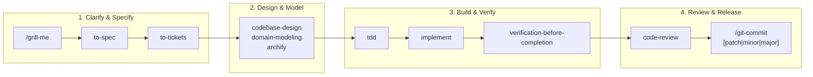

# ZentoraDev - Implementation phases

Review: evidence-backed workflow map; pending developer review. This document does not track live task status.

## Documentation onboarding sequence

1. Inspect workspace code, instructions, templates, existing architecture references, and canonical memory locations.
2. Draft the six root documents and interview the developer about unresolved product decisions. Acceptance: observed facts are traceable and proposed behavior is distinguished from current implementation.
3. After review, consolidate superseded planning content and leave redirects. Acceptance: incoming links resolve and setup instructions, architecture artifacts, central records, ADRs, and tickets retain their homes.
4. Verify root links and affected tooling in isolated fixtures. Acceptance: documentation and test checks pass, with external platform limitations reported separately.

These phases define the workflow, not a new approved feature roadmap or a duplicate implementation checklist.

## Canonical execution records

Specs and tickets live under `.scratch/<feature-slug>/`, following [issue tracker conventions](agents/issue-tracker.md). Keep ticket status in those files. Live project status and next steps belong only to [the ZentoraDev project card](../MyOS/projects/zentoradev.md).

## Open questions

Confirm additional milestones through the developer interview before creating implementation tickets. No automatic all-repo migration or security release gate is included.

## Agent lifecycle and release workflow

ZentoraDev governs autonomous AI coding agents through structured development lifecycles, mandatory evidence gates, and release automation.

---

### 1. The AI Hero Engineering Lifecycle

Agents operate according to a phased, rigorous lifecycle:



---

### 2. Mandatory Verification Gate (`verification-before-completion`)

No code change may be committed, merged, or declared complete without fresh verification evidence:
1. **Adaptive Toolchain Execution:** Dynamically executes the target repo's native verification tools (e.g., `npm run lint:fix`, `npm run build`, `npm test`, `pytest`, `cargo test`).
2. **Strict Zero-Exit-Code Requirement:** Commands must exit with code `0`. If errors occur, the agent must diagnose and resolve them before continuing.
3. **Pre-Commit Portability Guard:** Before staging git commits, `check_portable_paths.py --staged` runs automatically to block drive letters (`C:`, `F:`) and UTF-8 BOM corruptions.

---

### 3. Atomic Git Commit & Production Release Pipeline (`/git-commit`)

ZentoraDev provides a unified, single-command release pipeline via the `/git-commit` skill:

| Invocation | Changelog Action | Git Action | GitHub Release |
| :--- | :--- | :--- | :--- |
| **`/git-commit`** (Normal) | Appends technical bullets under `## [Unreleased]` matching existing format. | Creates atomic conventional commit (`feat:`, `fix:`, `refactor:`). | None |
| **`/git-commit patch`** | Promotes `## [Unreleased]` to `## [X.Y.Z] - YYYY-MM-DD`. | Fast-forwards `production` from `main`; creates annotated git tag `vX.Y.Z`. | None |
| **`/git-commit minor`** | Promotes `## [Unreleased]` to `## [X.Y.0] - YYYY-MM-DD`. | Fast-forwards `production` from `main`; creates annotated git tag `vX.Y.0`. | None |
| **`/git-commit major`** | Promotes `## [Unreleased]` to `## [X.0.0] - YYYY-MM-DD`. | Fast-forwards `production` from `main`; creates annotated git tag `vX.0.0`. | **Triggers `gh release create`** |

---

### 4. Curated global skills

Global skills live in `~/.agents/skills/` and are mirrored in `<ZENTORA_ROOT>/MyOS/_meta/global-skills/`. To maintain zero token bloat, non-coding courseware and duplicate skills were pruned:

| Core Skill | Role & Responsibility |
| :--- | :--- |
| **`grill-me`** | Interactive interview to resolve design decisions before building. |
| **`to-spec`** | Formalize user requirements into actionable technical specifications. |
| **`to-tickets`** | Break down specifications into atomic, testable engineering tasks. |
| **`archify`** | Create interactive standalone HTML + Mermaid system architecture diagrams. |
| **`domain-modeling`** | Build ubiquitous domain models, ADRs, and glossary terms. |
| **`codebase-design`** | Design deep modules, seam boundaries, and information hiding. |
| **`design-taste-frontend`** | Anti-slop frontend design system enforcement for landing pages and UIs. |
| **`implement`** | Execute code implementation conforming to specifications. |
| **`tdd`** | Test-driven development loop (Red -> Green -> Refactor). |
| **`verification-before-completion`** | Mandatory evidence gate (lint, build, and tests exit 0). |
| **`code-review`** | Automated parallel review across Spec compliance and Code Standards. |
| **`diagnosing-bugs`** | Root cause analysis and diagnosis loop for hard bugs and regressions. |
| **`git-commit`** | Conventional atomic commits with Keep a Changelog releases. |
| **`selfhost-devops`** | Self-hosted Linux deployments, Docker compose, and Cloudflare tunnels. |
| **`monorepo-architect`** | Turborepo multi-package boundaries and dependency graph enforcement. |
| **`setup-pre-commit`** | Husky pre-commit hooks, lint-staged, and typecheck automation. |

#### Global Deduplication Invariant
Individual child repositories in `Repos/` must **NEVER** duplicate these global skills in their local `.agents/skills/` directories. Local skill directories contain strictly repo-specific business domain skills.

---

### 5. Child Repository Onboarding (`bootstrap <RepoName>`)

To onboard any new or existing repository, run:
```powershell
powershell -ExecutionPolicy Bypass -File .\MyOS\_meta\bootstrap_repo.ps1 -RepoPath "Repos/MyProject"
```
Or instruct the agent:
> `bootstrap MyProject`

**Automated actions performed:**
1. Scaffolds `.agents/rules/00-zentora-and-ai-hero.md`, `AGENTS.md`, and `CHANGELOG.md` with `## [Unreleased]`.
2. Prunes any duplicate global skills from local `.agents/skills/`.
3. Creates the ICM Project Card (`MyOS/projects/myproject.md`) and Obsidian Project Hub (`MyOS/ObsidianVault/10 - Projects/MyProject/MyProject Hub.md`).
4. Creates missing six-file planning templates through the shared scaffolder and prints the interview prompt. Automatic reconciliation is a separate `zentora_sync.py` path; it does not launch interviews or audits.

The skill table above describes the established engineering workflow, not an exhaustive inventory. The current collection also includes setup and documentation tools and the on-demand `security-audit` skill; inspect `MyOS/_meta/global-skills/` for the authoritative inventory. See [root rules](RULES.md) for current verification and security runtime requirements.
