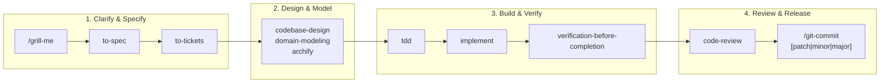

# Autonomous Agent Lifecycle & Governance

ZentoraDev governs autonomous AI coding agents through structured development lifecycles, mandatory evidence gates, and release automation.

---

## 1. The AI Hero Engineering Lifecycle

Agents operate according to a phased, rigorous lifecycle:



---

## 2. Mandatory Verification Gate (`verification-before-completion`)

No code change may be committed, merged, or declared complete without fresh verification evidence:
1. **Adaptive Toolchain Execution:** Dynamically executes the target repo's native verification tools (e.g., `npm run lint:fix`, `npm run build`, `npm test`, `pytest`, `cargo test`).
2. **Strict Zero-Exit-Code Requirement:** Commands must exit with code `0`. If errors occur, the agent must diagnose and resolve them before continuing.
3. **Pre-Commit Portability Guard:** Before staging git commits, `check_portable_paths.py --staged` runs automatically to block drive letters (`C:`, `F:`) and UTF-8 BOM corruptions.

---

## 3. Atomic Git Commit & Production Release Pipeline (`/git-commit`)

ZentoraDev provides a unified, single-command release pipeline via the `/git-commit` skill:

| Invocation | Changelog Action | Git Action | GitHub Release |
| :--- | :--- | :--- | :--- |
| **`/git-commit`** (Normal) | Appends technical bullets under `## [Unreleased]` matching existing format. | Creates atomic conventional commit (`feat:`, `fix:`, `refactor:`). | None |
| **`/git-commit patch`** | Promotes `## [Unreleased]` to `## [X.Y.Z] - YYYY-MM-DD`. | Fast-forwards `production` from `main`; creates annotated git tag `vX.Y.Z`. | None |
| **`/git-commit minor`** | Promotes `## [Unreleased]` to `## [X.Y.0] - YYYY-MM-DD`. | Fast-forwards `production` from `main`; creates annotated git tag `vX.Y.0`. | None |
| **`/git-commit major`** | Promotes `## [Unreleased]` to `## [X.0.0] - YYYY-MM-DD`. | Fast-forwards `production` from `main`; creates annotated git tag `vX.0.0`. | **Triggers `gh release create`** |

---

## 4. The 16 Pruned Core Global Skills

Global skills live in `~/.agents/skills/` and are mirrored in `<ZENTORA_ROOT>/MyOS/_meta/global-skills/`. To maintain zero token bloat, non-coding courseware and duplicate skills were pruned:

| Core Skill | Role & Responsibility |
| :--- | :--- |
| **`grill-me`** | Interactive interview to resolve design decisions before building. |
| **`to-spec`** | Formalize user requirements into actionable technical specifications. |
| **`to-tickets`** | Break down specifications into atomic, testable engineering tasks. |
| **`archify`** | Create interactive standalone HTML + Mermaid system architecture diagrams. |
| **`domain-modeling`** | Build ubiquitous domain models, ADRs, and glossary terms. |
| **`codebase-design`** | Design deep modules, seam boundaries, and information hiding. |
| **`design-taste-frontend`** | Anti-slop frontend design system enforcement for landing pages and UIs. |
| **`implement`** | Execute code implementation conforming to specifications. |
| **`tdd`** | Test-driven development loop (Red -> Green -> Refactor). |
| **`verification-before-completion`** | Mandatory evidence gate (lint, build, and tests exit 0). |
| **`code-review`** | Automated parallel review across Spec compliance and Code Standards. |
| **`diagnosing-bugs`** | Root cause analysis and diagnosis loop for hard bugs and regressions. |
| **`git-commit`** | Conventional atomic commits with Keep a Changelog releases. |
| **`selfhost-devops`** | Self-hosted Linux deployments, Docker compose, and Cloudflare tunnels. |
| **`monorepo-architect`** | Turborepo multi-package boundaries and dependency graph enforcement. |
| **`setup-pre-commit`** | Husky pre-commit hooks, lint-staged, and typecheck automation. |

### Global Deduplication Invariant
Individual child repositories in `Repos/` must **NEVER** duplicate these global skills in their local `.agents/skills/` directories. Local skill directories contain strictly repo-specific business domain skills.

---

## 5. Child Repository Onboarding (`bootstrap <RepoName>`)

To onboard any new or existing repository, run:
```powershell
powershell -ExecutionPolicy Bypass -File .\MyOS\_meta\bootstrap_repo.ps1 -RepoPath "Repos/MyProject"
```
Or instruct the agent:
> `bootstrap MyProject`

**Automated actions performed:**
1. Scaffolds `.agents/rules/00-zentora-and-ai-hero.md`, `AGENTS.md`, and `CHANGELOG.md` with `## [Unreleased]`.
2. Prunes any duplicate global skills from local `.agents/skills/`.
3. Creates the ICM Project Card (`MyOS/projects/myproject.md`) and Obsidian Project Hub (`ObsidianVault/10 - Projects/MyProject/MyProject Hub.md`).
4. Reconciles state in `zentora_sync.py` and registers project short-codes.
