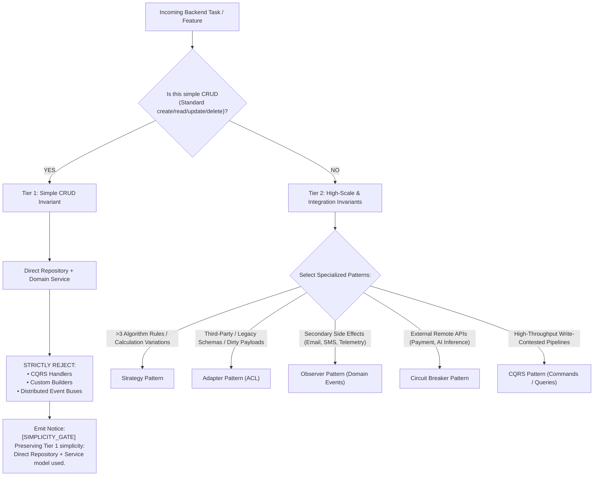

# Zentora Backend Engineering Protocols (ZEP)

The Zentora Backend Engineering Protocols (ZEP) enforce architectural discipline, prevent premature overengineering, and guarantee clean separation of concerns across client repositories.

---

## 1. The Two-Tier Simplicity Gate

AI assistants often suffer from overengineering bias—introducing complex event buses, CQRS handlers, or dynamic builders for simple database records. ZentoraDev enforces a strict **Two-Tier Simplicity Gate**:

---

## 2. The 10 Codified Backend Design Patterns

Codified in `MyOS/ObsidianVault/30 - Resources/Atomic Insights/`:

| Pattern | Problem Solved | Zentora Standard | Polyglot Implementation |
| :--- | :--- | :--- | :--- |
| **Repository** | Controller bloat & database lock-in | Decouple data access behind domain interfaces; controllers depend only on injected services. | **TS:** `interface UserRepository` + Prisma/Drizzle **Py:** `typing.Protocol` + SQLAlchemy |
| **Factory** | Leaking provider branching (`if stripe`, `elif paypal`) | Centralize instantiation into dedicated factory classes returning uniform interfaces. | **TS:** `PaymentFactory.get(type)` **Py:** `StorageFactory.get_provider()` |
| **Singleton** | Redundant heavy resource instantiation | Restrict strictly to stateless clients & connection pool managers; warn against mutable state. | **TS:** NestJS `@Injectable({ scope: DEFAULT })` **Py:** FastAPI app lifespan dependencies |
| **Strategy** | Deeply nested conditionals (>3 branches) | Encapsulate variant business algorithms into polymorphic strategy classes. | **TS:** `PricingStrategy` **Py:** `SurveyComputationStrategy` |
| **Observer** | Tightly coupled side effects bloating transactions | Emit domain events (`order.placed`); secondary subscribers handle side effects asynchronously. | **TS:** `EventEmitter2` / domain event bus **Py:** `asyncio` event dispatcher |
| **Builder** | Fragile constructors with 5+ positional args | Fluent step-by-step assembly with validation deferred until `.build()`. | **TS:** Fluent Builder / typed options object **Py:** Pydantic v2 model builders |
| **Adapter** | Dirty external/legacy schemas polluting domain | Dedicated Anti-Corruption Layer (ACL) classes translating foreign payloads at boundaries. | **TS:** `class SurveyAdapter Port` **Py:** Pydantic schema mappers |
| **Decorator** | Cross-cutting concerns in core functions | Wrap domain services transparently with middleware or decorators (caching, logging, metrics). | **TS:** NestJS Interceptors / TS decorators **Py:** `@functools.wraps` / FastAPI dependencies |
| **CQRS** | Read/write contention in high-throughput engines | Segregate Command writes from Query reads; strictly rejected for standard CRUD. | **TS:** Prisma transactions vs direct read queries **Py:** Write domain services vs FastAPI query schemas |
| **Circuit Breaker** | Cascading timeouts when external APIs hang | Stateful breaker (`CLOSED` -> `OPEN` -> `HALF-OPEN`) with mandatory fallback degradation. | **TS:** `opossum` / `cockatiel` **Py:** `pybreaker` / tenacity retry wrappers |

---

## 3. Boundary Enforcement

Route handlers, NestJS controllers, Express routers, and FastAPI endpoints are strictly insulated:
1. **No Direct Database Access:** Handlers must never call raw SQL, inline queries, or direct Prisma/SQLAlchemy models.
2. **No Uninsulated External Fetching:** Handlers must never make direct third-party HTTP calls; external APIs must be abstracted behind Adapter and Circuit Breaker interfaces.

---

## 4. Progressive Rule Slicing (`.cursor/rules/backend-patterns.mdc`)

To prevent token waste, `.cursor/rules/backend-patterns.mdc` uses **Progressive Rule Slicing**:
- `alwaysApply: false`
- Scoped strictly to backend language globs (`**/*.ts`, `**/*.tsx`, `**/*.py`, `**/*.js`, `**/*.mjs`, `**/backend/**`, `**/src/**`, `**/apps/api/**`).
- Inactive during documentation, git-commit, or markdown workflows, saving hundreds of prompt tokens per turn.
