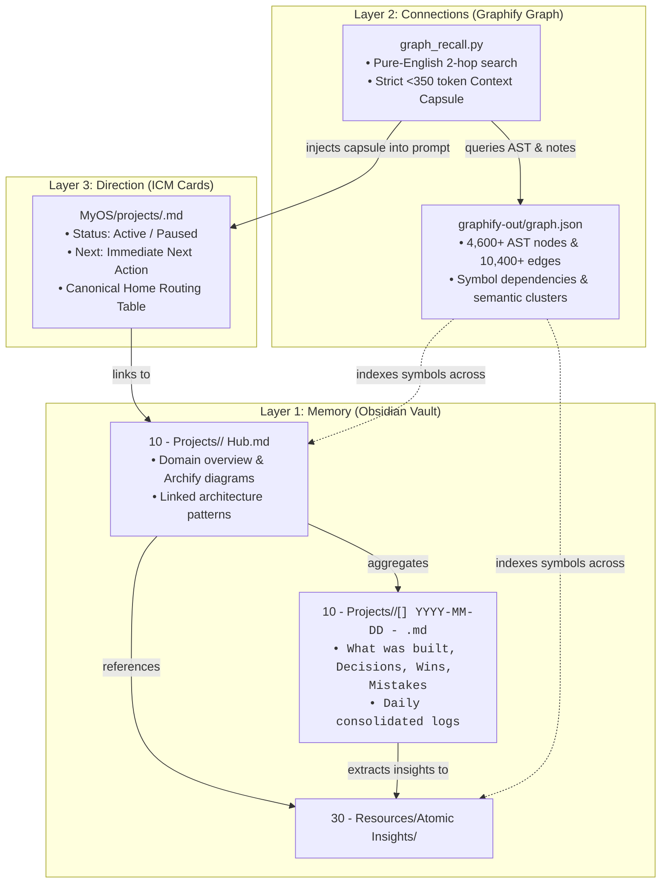

# MyOS — The 3-Layer Knowledge Architecture

MyOS (Meta-Developer OS) powers ZentoraDev by separating long-term history, cross-system relational connectivity, and immediate task direction into three specialized layers.

---

## 1. Architectural Model



---

## 2. Layer 1: Memory (Obsidian Vault)

Located at `<ZENTORA_ROOT>/MyOS/ObsidianVault/`. The vault contains historical context, architectural reasoning, and reusable domain solutions.

### Strict Folder Resolution Guardrail
Markdown notes must **NEVER** be written to the vault root (`MyOS/ObsidianVault/`). Files are strictly organized into designated folders:

1. **`10 - Projects/<Project Name>/`**:
   - **Hub Note (`<Project Name> Hub.md`):** Serves as the permanent anchor for the repository. Links interactive Archify architecture diagrams, relevant Backend Design Patterns, and session history.
   - **Consolidated Session Note (`[<CODE>] YYYY-MM-DD - <Focus Title>.md`):** One single note per project per day. When saving progress multiple times in one day, additional commits are appended under `## What was built` rather than spawning duplicate files.
   - **Project Short-Codes:** Registered in `_meta/git-hooks/post-commit` and `zentora_sync.py`:
     `DEV` (DevKernel), `STA` (Starter-Project).

2. **`30 - Resources/Atomic Insights/`**:
   - Reusable, atomic insights, non-obvious bug workarounds ("gotchas"), and architectural design patterns.
   - **5-Word / 35-Character Filename Rule:** Filenames are concept-first (e.g. `Repository Pattern.md`, `One Home Per Fact.md`). Full propositional statements live inside the YAML `summary:` and `# H1` header.

3. **`Templates/`**:
   - Standard templates for Hub Notes, Session Notes, Atomic Insights, and the child repository bootstrapper (`repo-agents-starter/`).

---

## 3. Layer 2: Connections (Graphify Relational Graph)

Located at `<ZENTORA_ROOT>/MyOS/graphify-out/`. Graphify maintains an AST symbol index and DeepSeek semantic knowledge graph across all tracked files.

### Zero-Token Context Capsule Generator (`graph_recall.py`)
Rather than sending entire markdown notes into an LLM context window, agents invoke:
```powershell
python MyOS/_meta/graph_recall.py "<query>" --hops 2
```
This performs a local 2-hop graph traversal and generates a compact **Context Capsule** strictly budgeted under **350 tokens**:
- Active project status & immediate next step
- Linked Atomic Insights summaries
- Relevant dated session notes (Decisions & Mistakes)
- Directly connected AST code symbol nodes

### Exact CLI Syntax (Zero-Token-Waste Rule)
> **CRITICAL:** `update` and `extract` are subcommands, **NOT** flags (`--update` is invalid):
- **Fast AST Code Re-Index (Routine / Free):**
  ```powershell
  graphify update "MyOS" --force
  ```
- **Semantic LLM Extraction (Major Milestones / Deep Re-Index):**
  ```powershell
  graphify extract "MyOS" --backend deepseek --output "MyOS"
  ```

---

## 4. Layer 3: Direction (Interpretable Context Methodology — ICM)

Located at `<ZENTORA_ROOT>/MyOS/projects/<project-slug>.md`. Each active or archived project has an authoritative 1-page ICM project card.

### Card Format
```markdown
---
type: project
status: active
next: Scaffolding starter service and test suite
updated: 2026-10-27
---
# Starter-Project

## Home
| Source | Path |
| :--- | :--- |
| Repo | `<ZENTORA_ROOT>/Repos/Starter-Project` |
| Memory | `<ZENTORA_ROOT>/MyOS/projects/starter-project.md` |
| Vault Folder | `<ZENTORA_ROOT>/MyOS/ObsidianVault/10 - Projects/Starter-Project` |
| Graph | `<ZENTORA_ROOT>/MyOS/graphify-out/graph.json` |
| Skills | `devkernel-manager`, `git-commit`, `verification-before-completion` |
```

---

## 5. Autonomous Reconciliation Engine (`zentora_sync.py`)

ZentoraDev includes a standalone reconciliation engine (`MyOS/_meta/zentora_sync.py`) that monitors the filesystem:
- **`--once`:** Executes a single discovery pass, reconciles project cards and vault hubs, runs portability guards, and triggers AST graph re-indexing.
- **`--watch`:** Launches a continuous 10-second debounced watcher loop that syncs modified files in the background without user intervention.
