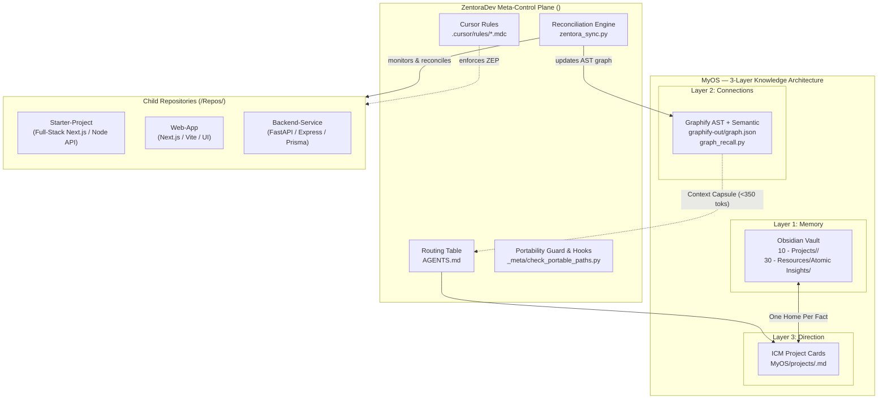

# ZentoraDev — Meta-Developer Operating System Overview

ZentoraDev is a local-first **Meta-Developer Operating System (MyOS)** designed to orchestrate autonomous AI pair programming across multiple independent client repositories. It enforces disciplined engineering guardrails, maintains persistent cross-session memory, and eliminates token waste through automated 2-hop knowledge graph retrieval.

---

## 1. What ZentoraDev Is & What It Is Used For

In multi-repository development environments, AI coding assistants (such as Google Antigravity, Cursor, and Claude Code) suffer from three fatal flaws when switching across projects:
1. **Context Amnesia:** Every new chat session loses prior architectural decisions, historical bugs, and database schemas.
2. **Context Window Saturation:** Dumping entire codebases or unindexed notes into prompts exhausts token budgets and leads to hallucinated implementations.
3. **Architectural Drift:** Without strict protocols, AI assistants introduce inconsistent patterns, violate separation of concerns, and overengineer simple CRUD workflows.

**ZentoraDev solves these challenges by acting as the central intelligence and control plane:**
- **Centralized Long-Term Memory:** Retains all dated session logs, architectural decisions, and atomic gotchas in an Obsidian Vault (`MyOS/ObsidianVault/`).
- **Graph-Powered Zero-Token Retrieval:** Maintains an AST symbol dependency graph and semantic community map (`graphify-out/graph.json`) to inject precise, <350 token Context Capsules.
- **Strict Architectural Governance:** Enforces the 10 Backend Engineering Protocols (ZEP) and a Two-Tier Simplicity Gate across all child projects in `Repos/`.
- **Autonomous Tooling Bootstrapper:** Onboards client repositories with zero manual configuration using automated pre-commit guards, git hooks, and portable paths.

---

## 2. High-Level System Architecture

---

## 3. Core Operating Invariants

### Invariant 1: One Home Per Fact (Routing Integrity)
Each piece of project information has exactly one canonical owner to prevent conflicting state:
- **Live Status & Next Immediate Task:** Lives **ONLY** in `MyOS/projects/<project-slug>.md`.
- **Session History, Decisions & Wins:** Lives **ONLY** in `MyOS/ObsidianVault/10 - Projects/<Project Name>/[<CODE>] YYYY-MM-DD - <Focus Title>.md`.
- **Reusable Architectural Gotchas:** Lives **ONLY** in `MyOS/ObsidianVault/30 - Resources/Atomic Insights/`.
- **Code Dependencies & Relationships:** Lives **ONLY** in `MyOS/graphify-out/graph.json`.

### Invariant 2: Zero Token Waste
Routine prompts must never force AI agents to re-read multi-thousand-line repositories or unindexed vaults:
- Pre-flight discovery relies on `graph_recall.py` to extract concise 2-hop subgraphs under 350 tokens.
- Routine updates run fast local AST re-indexing (`graphify update "MyOS"`), consuming zero LLM API tokens.

### Invariant 3: Zero Drive Letter Dependencies (Absolute Portability)
ZentoraDev repositories run on any workstation, drive letter, or operating system:
- Hardcoded drive paths (`C:`, `D:`, `F:`) and UTF-8 Byte Order Marks (BOM) are strictly blocked by git pre-commit hooks (`check_portable_paths.py`).
- Runtime scripts resolve the workspace root dynamically via `Path(__file__).resolve().parents[2]` or PowerShell `(Get-Location).Path`.
