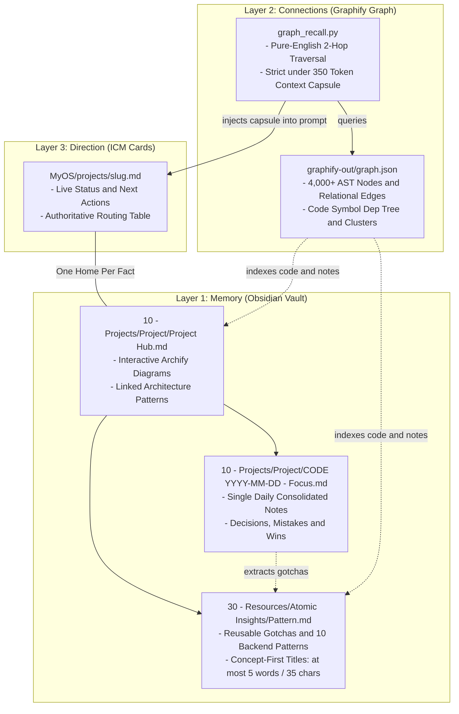
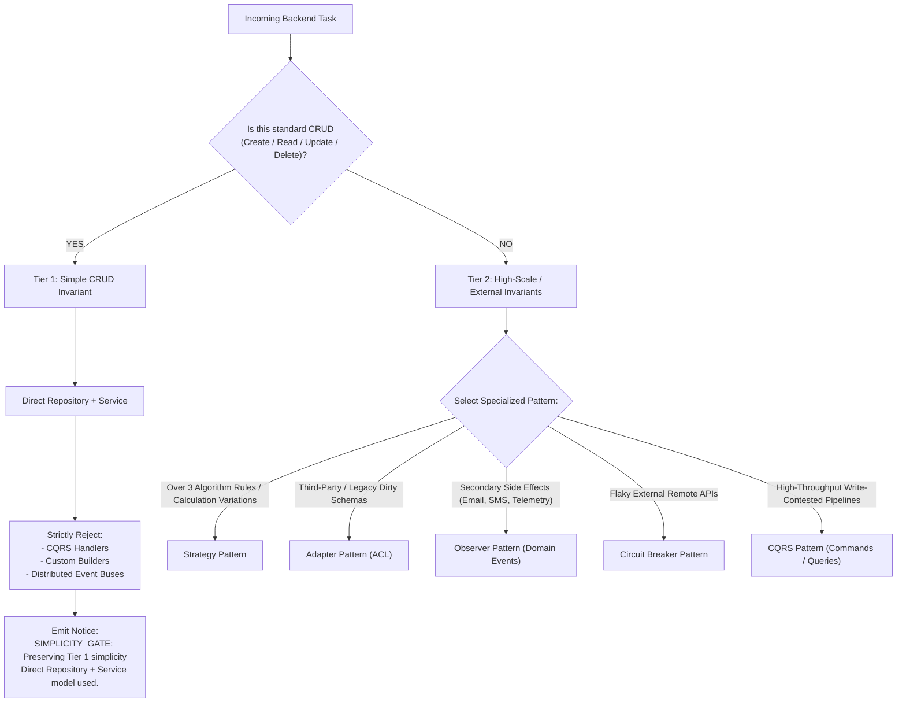

# DevKernel — Meta-Developer Operating System (MyOS)

> **A 3-Layer Autonomous Knowledge & Engineering Operating System for Multi-Repository AI Pair Programming.**

DevKernel is a local-first **Meta-Developer Operating System (MyOS)** built on the **"One Home Per Fact"** principle. It bridges local Obsidian long-term memory, relational AST + semantic knowledge graphs (Graphify + DeepSeek), and structured Interpretable Context Methodology (ICM) project cards to empower AI coding assistants with instant, zero-token-waste context recall and disciplined engineering lifecycles.

---
## 1. The 3-Layer Knowledge Architecture



| Layer | System | Location | Purpose |
| :--- | :--- | :--- | :--- |
| **Layer 1: Memory** | **Obsidian Vault** | `MyOS/ObsidianVault/10 - Projects/<Name>/`<br/>`MyOS/ObsidianVault/30 - Resources/Atomic Insights/` | Full chronological session logs, architectural decisions, and reusable Atomic Insights notes. Notes never live at the vault root. |
| **Layer 2: Connections** | **Graphify + DeepSeek** | `MyOS/graphify-out/graph.json`<br/>`MyOS/_meta/graph_recall.py` | Cross-module symbol dependencies, call hierarchies, semantic communities, and <350 token Context Capsule generation. |
| **Layer 3: Direction** | **ICM Project Cards** | `MyOS/projects/<project-slug>.md` | Authoritative single-page project cards holding live status, immediate next steps, and resource paths. |

---

## 2. DevKernel Backend Engineering Protocols (ZEP)

To prevent premature overengineering while ensuring scalable abstractions, DevKernel enforces the **10 Backend Design Patterns** and a **Two-Tier Simplicity Gate**:



### The 10 Codified Backend Patterns
1. **Repository Pattern:** Controller insulation; data access decoupled behind domain repository interfaces (`Prisma`/`Drizzle` in TS, `SQLAlchemy` in Python).
2. **Factory Pattern:** Encapsulates multi-provider branching behind centralized instantiation factories.
3. **Singleton Pattern:** Manages heavy lifecycle resources (pools, caches); strictly forbids mutable global state.
4. **Strategy Pattern:** Isolates interchangeable algorithms into polymorphic strategy classes (>3 branches).
5. **Observer Pattern:** Publishes domain events (`order.placed`) to decouple asynchronous secondary side effects.
6. **Builder Pattern:** Fluent step-by-step assembly for complex 5+ parameter payloads and test factories.
7. **Adapter Pattern:** Translates external/legacy schemas into clean internal domain models at boundaries.
8. **Decorator Pattern:** Attaches cross-cutting concerns (caching, logging, metrics) transparently without mutating domain services.
9. **CQRS Pattern:** Segregates write Commands from read Queries; strictly restricted to high-throughput domains.
10. **Circuit Breaker Pattern:** Stateful failure protection (`CLOSED` -> `OPEN` -> `HALF-OPEN`) with mandatory fallback degradation.

---

## 3. Progressive Rules & The 16 Core Bundled Global Skills

### Progressive Rule Slicing (`.cursor/rules/`)
- **`devkernel.mdc` (`alwaysApply: true`):** Master routing table, One Home Per Fact, PowerShell 5.1 guardrails, and Graphify CLI syntax.
- **`backend-patterns.mdc` (`alwaysApply: false`):** Activates strictly when editing backend code (`**/*.ts`, `**/*.py`, `**/backend/**`, etc.), enforcing controller insulation, anti-overengineering linter, and polyglot gates without bloating non-code prompts.

### 16 Core Pruned Global Skills (`~/.agents/skills/`)
To eliminate token waste and courseware bloat, DevKernel bundles a streamlined 16-skill engineering suite:
- **Clarify & Specify:** `grill-me`, `to-spec`, `to-tickets`
- **Design & Model:** `archify`, `domain-modeling`, `codebase-design`, `design-taste-frontend`
- **Build & Verify:** `implement`, `tdd`, `verification-before-completion`, `code-review`, `diagnosing-bugs`
- **Release & Ops:** `git-commit`, `selfhost-devops`, `monorepo-architect`, `setup-pre-commit`

> **Deduplication Invariant:** Child repositories in `Repos/` must **NEVER** duplicate these global skills locally; local `.agents/skills/` folders contain strictly project-specific domain skills.

---

## 4. Quickstart & Machine Onboarding

When setting up DevKernel on a new workstation:

```powershell
# 1. Clone the repository
git clone <your-devkernel-repo-url>.git
cd DevKernel

# 2. Run the automated 1-step bootstrapper
powershell -ExecutionPolicy Bypass -File .\MyOS\_meta\bootstrap_machine.ps1
```

### What `bootstrap_machine.ps1` Does:
1. Restores the **16 core engineering skills** from `MyOS/_meta/global-skills/` to your user profile (`~/.agents/skills/`).
2. Creates Windows directory junctions to Antigravity and Gemini skill directories.
3. Initializes `MyOS/.env.graphify` from `.env.graphify.example`.
4. Installs Git pre-commit and post-commit hooks for portability and automatic session telemetry.
5. Calibrates local state with `zentora_sync.py --once`.

---

## 5. Development Workflows

### 1. Bootstrapping a Child Repository (`bootstrap <RepoName>`)
To connect any new or existing repository in `Repos/` to DevKernel:
```powershell
powershell -ExecutionPolicy Bypass -File .\MyOS\_meta\bootstrap_repo.ps1 -RepoPath "MyProject"
```
Or tell the agent: `bootstrap MyProject`. This automatically scaffolds `.agents/rules/00-zentora-and-ai-hero.md`, `AGENTS.md`, `CHANGELOG.md` with `## [Unreleased]`, prunes duplicate skills, and creates the ICM Card and Obsidian Hub.

### 2. High-Efficiency Context Recall (Zero Token Waste)
Before guessing or reading full directories, query the 2-hop relational knowledge graph:
```powershell
python MyOS/_meta/graph_recall.py "<query>" --hops 2
```
Generates a strict <350 token Context Capsule including project status, linked Atomic Insights, recent session decisions, and AST symbol dependencies.

### 3. Unified Git Commit & Production Release (`/git-commit`)
- **Standard Atomic Commit (`/git-commit`):** Appends technical bullets under `## [Unreleased]` in `CHANGELOG.md` and creates an atomic conventional commit.
- **Release Version (`/git-commit patch|minor|major`):** Promotes `## [Unreleased]` to `## [X.Y.Z] - YYYY-MM-DD`, updates the `production` branch from `main`, creates an annotated git tag `vX.Y.Z`, and triggers a **GitHub Release (`gh release create`) ONLY on `major` updates**.

### 4. Persisting Memory (`save progress`)
Say **`save progress`** to:
1. Record or append to today's consolidated session note: `ObsidianVault/10 - Projects/<Project>/[<CODE>] YYYY-MM-DD - <Focus Title>.md`.
2. Extract reusable architecture insights or non-obvious bugs into `ObsidianVault/30 - Resources/Atomic Insights/`.
3. Update `status`, `next`, and `updated` in `MyOS/projects/<project-slug>.md`.
4. Run fast local AST graph update `graphify update "MyOS"` (zero LLM tokens).

---

## 6. Directory Structure

```text
DevKernel/
├── .agents/                        # Agent skills & workspace skills.json
├── .cursor/rules/                  # Cursor IDE rules (devkernel.mdc, backend-patterns.mdc)
├── .docs/                          # System Architecture & Agent Standards
│   ├── architecture/               # Modular deep-dive architectural specifications
│   │   ├── system-overview.md      # Mission, invariants & high-level architecture
│   │   ├── knowledge-layers.md     # 3-Layer MyOS deep dive & Context Capsule
│   │   ├── backend-engineering-protocols.md # ZEP & Two-Tier Simplicity Gate
│   │   └── agent-lifecycle.md      # AI Hero lifecycle & /git-commit release pipeline
│   ├── agents/                     # Domain doc standards, issue tracker & triage roles
│   └── README.md                   # Documentation index
├── MyOS/                           # Meta-Developer Operating System
│   ├── ObsidianVault/              # Long-term Obsidian memory & session archives
│   │   ├── 10 - Projects/          # Project Hub notes and dated session notes
│   │   ├── 30 - Resources/         # Atomic Insights & reusable gotchas
│   │   └── Templates/              # Note & child repo templates
│   ├── projects/                   # ICM Project Cards (<slug>.md)
│   ├── graphify-out/               # 2-hop Graphify AST graph, reports, and HTML
│   ├── dashboards/                 # High-level tracker dashboards
│   ├── _meta/                      # Sync scripts, git hooks, and machine bootstrapper
│   │   └── global-skills/          # 16 core engineering protocols
│   └── .env.graphify.example       # DeepSeek API configuration template
├── Repos/                          # Child project repositories (ignored by Git)
│   └── .gitkeep
├── .gitignore                      # Strict isolation for child repos & secrets
├── AGENTS.md                       # Master ICM workspace routing table
├── CHANGELOG.md                    # Keep a Changelog workspace history
└── README.md                       # Master workspace guide
```

---

## 7. Deep-Dive Architecture Documentation

For complete technical specifications, see:
- [System Overview](.docs/architecture/system-overview.md)
- [3-Layer Knowledge Architecture](.docs/architecture/knowledge-layers.md)
- [Backend Engineering Protocols (ZEP)](.docs/architecture/backend-engineering-protocols.md)
- [Agent Lifecycle & Release Pipeline](.docs/architecture/agent-lifecycle.md)
- [Documentation Index](.docs/README.md)
